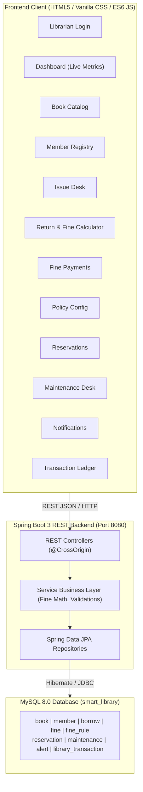

# Smart Library Resource Management & Automated Fine Calculator

> A practical, full-stack, enterprise-grade Smart Library Management System featuring real-time resource tracking, member lifecycle management, circulation desk operations, automated overdue fine calculations, book reservation hold queues, preservation & maintenance tracking, and full transaction auditing.

---

## 📋 Table of Contents
1. [Project Overview](#-project-overview)
2. [Problem Statement](#-problem-statement)
3. [Objectives](#-objectives)
4. [System Architecture](#-system-architecture)
5. [Key Modules & Features](#-key-modules--features)
6. [Automated Fine Calculation Logic](#-automated-fine-calculation-logic)
7. [Technology Stack](#-technology-stack)
8. [Database Design & Schema](#-database-design--schema)
9. [REST API Reference](#-rest-api-reference)
10. [Installation & Setup Guide](#-installation--setup-guide)
11. [Postman Testing & API Verification](#-postman-testing--api-verification)
12. [Default Credentials & Sample Data](#-default-credentials--sample-data)
13. [End-to-End Demonstration Workflow](#-end-to-end-demonstration-workflow)
14. [Future Enhancements](#-future-enhancements)

---

## 🌟 Project Overview
The **Smart Library Resource Management & Automated Fine Calculator** is built for educational institutions and community libraries. It replaces manual register ledgers and fragmented spreadsheets with a centralized, automated web-based platform. 

The application maintains a single source of truth in **MySQL**, managed via a **Spring Boot 3 (Java 21)** REST API backend, and presented through an intuitive, modern, responsive **HTML5/CSS3/JavaScript** frontend interface.

---

## 🎯 Problem Statement
Traditional library operations face numerous manual inefficiencies:
* **Manual Fine Calculations:** Overdue calculations are calculated by hand, leading to human errors, missed grace periods, and inconsistent penalty enforcement.
* **Stock & Shelf Discrepancies:** Hand-written registers cause delays in knowing whether copies are actually available, borrowed, or in repair.
* **Loss of Auditability:** Financial penalties collected in cash are often lost in paper logs without a linked transaction trail.
* **Absence of Hold/Reservation Notifications:** Patrons have no mechanism to queue for checked-out books or receive alerts when titles are checked back in.

---

## 🎯 Objectives
* Provide a single, unified librarian dashboard with live circulation metrics.
* Fully automate overdue days tracking and fine computation on the backend according to configurable library policies.
* Enforce strict availability and eligibility checks (e.g., blocking members with blocked/inactive status or zero available inventory).
* Deliver a transparent audit trail for every library action: additions, updates, borrowings, returns, fine levies, payments, reservations, and repairs.

---

## 🏛️ System Architecture



---

## 📦 Key Modules & Features

### 1. Librarian Control Dashboard (`dashboard.html`)
* **Real-time Metrics:** Total Cataloged Books, Available Copies, Borrowed Books, Overdue Loans, Total Members, Pending Fines (with outstanding ₹ amount), Active Reservations, and Items Under Maintenance.
* **Recent Activity Feed:** Live list of the last 10 system transactions.
* **Notification Center:** Instant broadcast of overdue loans, pending fines, and return alerts.

### 2. Book & Resource Repository (`books.html`)
* Add new titles with ISBN, Title, Author, Category, Publisher, Publication Year, Quantity, and Shelf Number.
* Real-time search across Title, Author, ISBN, and Category.
* Status filtering: `AVAILABLE`, `BORROWED`, `MAINTENANCE`, `RESERVED`.
* Safe deletion safeguards: books with active borrowings cannot be removed.

### 3. Member Management (`members.html`)
* Register patrons (Students, Faculty, Staff) with contact information and department.
* Status governance: `ACTIVE`, `INACTIVE`, `BLOCKED`.
* Blocked member protection: members marked as `BLOCKED` cannot borrow any books until unblocked.

### 4. Book Issue / Circulation Desk (`borrow.html`)
* Fast checkout by selecting active patron and available book.
* Real-time inventory check: decreases `available_quantity` by 1; marks status as `BORROWED` if inventory hits 0.
* Automatic due date computation (default 14 days loan duration).
* Instant audit transaction logged as `BOOK_ISSUED`.

### 5. Automated Fine Calculator & Return Desk (`return.html`)
* Searchable list of active borrowings.
* Interactive return modal with dynamic date selector.
* **Live Server-Side Calculation Preview:** Calculates overdue days, applies grace period deductions, multiplies by daily rate, caps at maximum fine.
* Automatic return processing: restores book inventory (+1 available copy), marks borrowing status as `RETURNED`, creates `Fine` record if overdue, logs `BOOK_RETURNED` transaction, and checks for reservation alerts.

### 6. Fine Management & Settlement (`fines.html`)
* Complete dues ledger with total collected vs outstanding stats.
* Filter by `PENDING` and `PAID`.
* One-click **"Mark Paid"** action: records payment date, updates payment status, logs `FINE_PAID` transaction, and decrements pending fines counter on the dashboard.

### 7. Fine Rules Configuration (`fine-rules.html`)
* Maintain configurable circulation policies:
  * **Fine Rate Per Day:** Default ₹5.00
  * **Grace Period:** Default 0 Days
  * **Maximum Fine Limit:** Default ₹100.00
  * **Scope:** All Members or Membership-specific
* Applied automatically by the Spring Boot backend on return.

### 8. Book Reservation & Hold Queue (`reservations.html`)
* Allows patrons to queue holds on currently checked-out or low-availability titles.
* Automated hold expiry tracking (7 days).
* Automatic alert generation when a reserved book is checked back in.

### 9. Maintenance & Repair Desk (`maintenance.html`)
* Move damaged books to repair status: deducts available copy, logs `MAINTENANCE_STARTED`.
* Complete repair: returns copy to active inventory, logs `MAINTENANCE_COMPLETED`, and generates system alert.

### 10. Audit Trail & Activity Ledger (`transactions.html`)
* Searchable log of all actions (`BOOK_ISSUED`, `BOOK_RETURNED`, `FINE_CREATED`, `FINE_PAID`, `BOOK_RESERVED`, `BOOK_ADDED`, etc.).

---

## 🧮 Automated Fine Calculation Logic

The calculation is executed entirely on the Spring Boot backend (`BorrowService.java`) ensuring a single source of truth:

$$\text{Overdue Days} = \text{Return Date} - \text{Due Date}$$

$$\text{Chargeable Days} = \max(0, \text{Overdue Days} - \text{Grace Period})$$

$$\text{Total Fine} = \min(\text{Chargeable Days} \times \text{Fine Per Day}, \text{Maximum Fine})$$

### Calculation Matrix Example:
| Due Date | Return Date | Overdue Days | Grace Period | Fine Rate | Max Fine | Total Calculated Fine |
| :--- | :--- | :--- | :--- | :--- | :--- | :--- |
| Sep 10 | Sep 10 | 0 | 0 | ₹5.00 | ₹100.00 | **₹0.00** |
| Sep 10 | Sep 15 | 5 | 0 | ₹5.00 | ₹100.00 | **₹25.00** |
| Sep 10 | Sep 15 | 5 | 2 | ₹5.00 | ₹100.00 | **₹15.00** |
| Sep 10 | Nov 10 | 61 | 0 | ₹5.00 | ₹100.00 | **₹100.00 (Capped)** |

---

## 💻 Technology Stack

* **Backend Framework:** Spring Boot 3.2.5 (Java 21 LTS)
* **Web Layer:** Spring Web MVC, RESTful APIs, Jakarta Validation
* **Persistence & ORM:** Spring Data JPA, Hibernate ORM
* **Database Driver:** MySQL Connector/J (`com.mysql:mysql-connector-j`)
* **Database:** MySQL 8.0+
* **Frontend:** HTML5, Modern Vanilla CSS3 (CSS Variables, Flexbox, CSS Grid, Glassmorphism), Vanilla JavaScript (ES6+ Fetch API, async/await)
* **Build Tool:** Apache Maven 3.9+
* **Testing:** Postman Collection v2.1

---

## 🗄️ Database Design & Schema

The application connects to the `smart_library` database in MySQL. The tables and relationships are defined below:

```sql
-- Main tables in smart_library
1. book (book_id, isbn, title, author, category, publisher, publication_year, quantity, available_quantity, shelf_number, status, created_at)
2. member (member_id, name, email, phone, department, membership_type, registration_date, status)
3. borrow (borrow_id, member_id, book_id, borrow_date, due_date, return_date, status)
4. fine (fine_id, borrow_id, member_id, overdue_days, fine_amount, fine_date, payment_date, payment_status)
5. fine_rule (rule_id, fine_per_day, grace_period, maximum_fine, membership_type, status)
6. reservation (reservation_id, member_id, book_id, reservation_date, expiry_date, status)
7. maintenance (maintenance_id, book_id, reason, start_date, expected_completion_date, actual_completion_date, status, remarks)
8. alert (alert_id, member_id, book_id, alert_type, message, created_date, read_status)
9. library_transaction (transaction_id, transaction_type, member_id, book_id, description, transaction_date, status)
```

### JPA Entity Relationships:
* `Member` $\xrightarrow{1:N}$ `Borrow`
* `Book` $\xrightarrow{1:N}$ `Borrow`
* `Borrow` $\xrightarrow{1:1}$ `Fine`
* `Member` $\xrightarrow{1:N}$ `Reservation`
* `Book` $\xrightarrow{1:N}$ `Reservation`
* `Book` $\xrightarrow{1:N}$ `Maintenance`
* `Member` / `Book` $\xrightarrow{1:N}$ `Alert` & `LibraryTransaction`

---

## 🔌 REST API Reference

Base URL: `http://localhost:8080/api`

| Module | Method | Endpoint | Description |
| :--- | :--- | :--- | :--- |
| **Auth** | `POST` | `/auth/login` | Librarian login authentication |
| **Dashboard** | `GET` | `/dashboard/summary` | Complete live metrics & feeds |
| **Books** | `GET` | `/books` | List books (supports `?search=` and `?status=`) |
| | `GET` | `/books/{id}` | Get book by ID |
| | `GET` | `/books/available` | List all books with available copies |
| | `POST` | `/books` | Add new book to catalog |
| | `PUT` | `/books/{id}` | Update existing book |
| | `DELETE` | `/books/{id}` | Delete book (if no active loans) |
| **Members** | `GET` | `/members` | List members (supports `?search=`) |
| | `GET` | `/members/{id}` | Get member by ID |
| | `POST` | `/members` | Register new member |
| | `PUT` | `/members/{id}` | Update member profile |
| | `DELETE` | `/members/{id}` | Delete member |
| **Borrow** | `GET` | `/borrows` | List all borrowings |
| | `GET` | `/borrows/active` | List currently loaned books |
| | `GET` | `/borrows/overdue` | List overdue borrowings |
| | `POST` | `/borrows` | Issue a book to a member |
| | `PUT` | `/borrows/{id}/return` | Check in book & calculate fine |
| **Fines** | `GET` | `/fines` | List all fines |
| | `GET` | `/fines/pending` | List uncollected fines |
| | `PUT` | `/fines/{id}/pay` | Settle & mark fine as paid |
| **Fine Rules** | `GET` | `/fine-rules` | List configured rules |
| | `GET` | `/fine-rules/active` | Get current active calculation rule |
| | `POST` | `/fine-rules` | Add new fine rule |
| | `PUT` | `/fine-rules/{id}` | Update fine rule parameters |
| **Reservations**| `GET` | `/reservations` | List reservations |
| | `POST` | `/reservations` | Place book on hold |
| | `PUT` | `/reservations/{id}/complete` | Fulfill reservation |
| | `PUT` | `/reservations/{id}/cancel` | Cancel reservation |
| **Maintenance**| `GET` | `/maintenance` | List repair records |
| | `POST` | `/maintenance` | Send book to maintenance |
| | `PUT` | `/maintenance/{id}/complete`| Complete repair & restore inventory |
| **Alerts** | `GET` | `/alerts` | Get alerts (supports `?status=UNREAD`) |
| | `PUT` | `/alerts/{id}/read` | Mark alert as read |
| | `PUT` | `/alerts/read-all` | Mark all alerts read |
| **Audit** | `GET` | `/transactions` | Full audit log (supports `?type=` and `?search=`) |

---

## 🚀 Installation & Setup Guide

### Prerequisites
* **Java 21 LTS** installed (`java -version`)
* **MySQL 8.0+** running on `localhost:3306`
* **Apache Maven** or Maven Wrapper

### Step 1: Clone / Open Project Folder
```powershell
cd "c:\Users\tamil\OneDrive\Documents\Desktop\Smart Library Resource Management2"
```

### Step 2: Create MySQL Database
Log in to MySQL and execute:
```sql
CREATE DATABASE IF NOT EXISTS smart_library;
```

### Step 3: Configure Database Credentials
Edit [backend/src/main/resources/application.properties](file:///c:/Users/tamil/OneDrive/Documents/Desktop/Smart%20Library%20Resource%20Management2/backend/src/main/resources/application.properties):
Set your MySQL password in the current PowerShell session. It is read from the `DB_PASSWORD` environment variable and is not stored in the source files:
```powershell
$env:DB_PASSWORD = Read-Host "MySQL password"
```

### Step 4: Build & Run the Backend
From the workspace root directory:
```powershell
mvn spring-boot:run -f backend/pom.xml
```
* The backend will start on port `8080`.
* Hibernate will automatically create all tables and foreign keys.
* `DataInitializer` will automatically seed sample books, members, active loans, overdue fines, and rules if the database is newly created.

### Step 5: Access the Frontend
Open your browser and navigate to:
```
http://localhost:8080/index.html
```
*(Or open `frontend/index.html` directly in any web browser).*

---

## 📬 Postman Testing & API Verification

The repository includes a ready-to-import Postman Collection:
📁 **[Smart_Library_API_Collection.postman_collection.json](file:///c:/Users/tamil/OneDrive/Documents/Desktop/Smart%20Library%20Resource%20Management2/Smart_Library_API_Collection.postman_collection.json)**

### How to Test:
1. Open Postman.
2. Click **Import** $\rightarrow$ Select `Smart_Library_API_Collection.postman_collection.json`.
3. The collection includes predefined requests across 10 folders:
   - `01 - Authentication`: Librarian Login
   - `02 - Dashboard`: Get Dashboard Summary
   - `03 - Books Management`: Get All, Search, Available, Add, Update, Delete
   - `04 - Members Management`: Get All, Add, Update, Delete
   - `05 - Borrowing & Circulation`: Issue Book, Return Book with Auto Fine
   - `06 - Fines & Policies`: Get Fines, Pending Fines, Pay Fine, Update Rule
   - `07 - Reservations`: Place Hold, Fulfill, Cancel
   - `08 - Maintenance`: Send to Repair, Complete Repair
   - `09 - Alerts`: Inbox, Mark Read
   - `10 - Transactions Audit Log`: Filter and search activity history
4. Run requests against `http://localhost:8080/api/...` to verify responses.

---

## 🔑 Default Credentials & Sample Data

### Librarian Credentials
* **Username:** `admin`
* **Password:** `admin123`
*(A convenient "Auto-fill Default Demo Credentials" button is provided on the login page).*

### Sample Seed Data Included
* **Books:**
  1. *Clean Code* – Robert C. Martin (Programming, Shelf: CS-01)
  2. *Introduction to Algorithms* – Thomas H. Cormen (Algorithms, Shelf: CS-02)
  3. *Database System Concepts* – Abraham Silberschatz (Database, Shelf: DB-01)
  4. *Computer Networks* – Andrew S. Tanenbaum (Networking, Shelf: NW-01)
  5. *Artificial Intelligence: A Modern Approach* – Stuart Russell (AI, Shelf: AI-01)
* **Members:**
  1. Arun (CSE – Student, Status: `ACTIVE`)
  2. Priya (CSE – Student, Status: `ACTIVE`)
  3. Karthik (ECE – Student, Status: `ACTIVE`)
  4. Divya (IT – Student, Status: `ACTIVE`)
  5. Rahul (CSE – Student, Status: `BLOCKED`)
* **Initial Circulation:**
  - 1 Active regular loan
  - 1 Overdue loan with ₹25.00 pending fine
  - 1 Active reservation hold
  - 1 Book under maintenance

---

## 🎬 End-to-End Demonstration Workflow

Follow these steps for a complete project evaluation or college presentation:

1. **Sign In:** Go to `http://localhost:8080/index.html`, click **Auto-fill Demo Credentials**, and sign in.
2. **Review Dashboard:** Inspect the live statistics cards (Total Books, Available Copies, Pending Fines, Overdue Books).
3. **Add a Book:** Go to **Manage Books** $\rightarrow$ Click **Add New Book** $\rightarrow$ Enter details $\rightarrow$ Save. Verify the table and available count update.
4. **Register a Member:** Go to **Manage Members** $\rightarrow$ Click **Register New Member** $\rightarrow$ Add student details.
5. **Issue a Book:** Go to **Issue Book** $\rightarrow$ Select your member and book $\rightarrow$ Click **Issue Book**. Notice that the available copy count decreases by 1 in MySQL.
6. **Simulate Return & Overdue Fine:** Go to **Return Book** $\rightarrow$ Click **Return Book** on a loan $\rightarrow$ Select a date 5 days past due date $\rightarrow$ Observe the live fine preview:
   $$\text{5 days overdue} \times ₹5/\text{day} = ₹25.00$$
   Click **Confirm Check-In**.
7. **Settle Fine:** Go to **Fines & Payments** $\rightarrow$ Filter by `Pending Only` $\rightarrow$ Click **Mark Paid** on the fine $\rightarrow$ Confirm payment. Notice the pending fine counter on the dashboard decrements.
8. **Place Reservation:** Go to **Reservations** $\rightarrow$ Select a book and member $\rightarrow$ Confirm hold.
9. **Book Maintenance:** Go to **Maintenance** $\rightarrow$ Send a book for binding $\rightarrow$ Confirm available inventory drops $\rightarrow$ Click **Complete & Restore** $\rightarrow$ Verify copy is restored.
10. **Audit Trail:** Go to **Transactions** and observe that every single operation performed above has been logged with an exact timestamp and description.

---

## 🔮 Future Enhancements
* Barcode / QR Code scanning for book checkout via USB scanner or webcam.
* RFID-based smart gate integration for auto-detecting unauthorized removals.
* Automated WhatsApp / Email return reminders 2 days prior to loan due dates.
* Razorpay / UPI payment gateway integration for direct patron fine settlement.
* Student Self-Service OPAC portal for search and reservation from mobile phones.

---
*Developed as a full-stack Smart Library Resource Management & Automated Fine Calculator project.*
